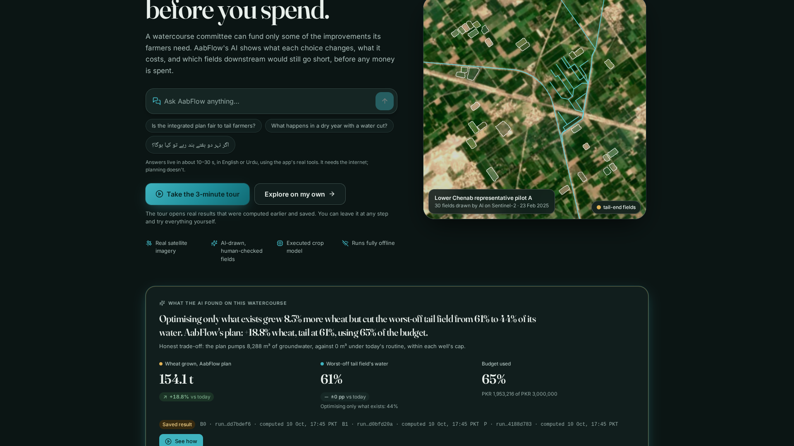
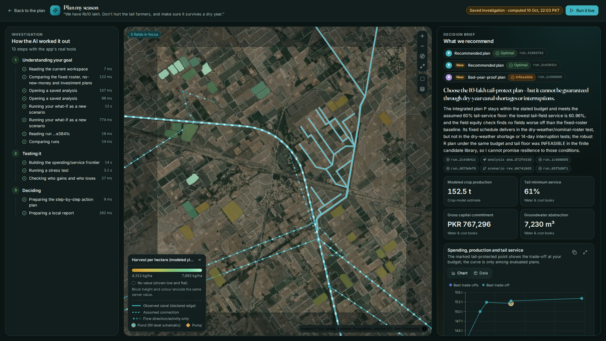

# AabFlow

**Test the season before you spend.**

AabFlow is an AI planning agent for village water committees in Punjab's canal-irrigated
areas. Before a rupee is spent, it shows how much crop each improvement grows, what it costs,
how much water it uses, and which farmers at the far end of the canal still go short.



Built for **AICON 2026**. Every number in the app comes from an executed run that you can trace.
Nothing is staged.

---

## The finding that started it

A few dozen farmers share one earthen *watercourse* and take fixed turns (*warabandi*). The
**tail** fields at the far end get water last. Each season the committee can fund only some
improvements: laser levelling, a farm pond, a canal repair, extra pumping.

On a real pilot (Lower Chenab pilot A, Rabi wheat 2027-28, 30 reviewed fields, ₨30 lakh budget):

| Plan | Wheat | Worst-off tail field gets | New capital |
|---|---|---|---|
| **B0** · today's fixed turns | 129.7 t | 61% of its water | ₨0 |
| **B1** · optimise what already exists | 140.5 t (+8.3%) | **44%** ⚠️ | ₨0 |
| **P** · AabFlow's integrated plan | **154.1 t (+18.8%)** | **61%** | ₨19.5 lakh (65% of budget) |

"Just optimise what we have" grows more wheat but **quietly takes water from the tail farmer**.
AabFlow catches that: more harvest, a fairer split, and money left over. The plan pumps
8,288 m³ of groundwater where today's routine pumps none. It says so on screen.

## Four AI engines, one loop: perceive → simulate → decide → explain

| Engine | What it does | Proof |
|---|---|---|
| **Sees** | *Delineate Anything* segmentation finds **931** possible fields on one Sentinel-2 image. Review rules and a person keep the 30 clearest. | Tour step "The AI reveal" |
| **Predicts** | A LightGBM model **we trained on GPU** on **45,619** executed AquaCrop simulations estimates yield in **~7 ms** (held-out error ≈ 7%). One click confirms it with the exact crop model. | What if › Quick estimate |
| **Plans** | An exact CP-SAT optimiser searches **7,745** candidate field policies and **proves** the best plan within them, then checks it against a day-by-day water ledger. | "Best plan proven" badge on every result |
| **Explains** | A GPT-6 Luna copilot with **27 real tools** answers in English or Urdu with server-built charts and tables. It never types a number: figures it cannot trace are withheld. | Ask box · Plan my season |

### Plan my season

Type one sentence, for example *"We have ₨10 lakh. Don't hurt the tail farmers, and make sure it
survives a dry year."* The agent then runs the whole investigation with the app's own tools,
streaming each step:

1. It solves the plan ladder.
2. It builds a budget frontier.
3. It stress-tests the plan across 9 weather × canal-supply states.
4. It checks who gains and who loses.
5. It writes a one-page decision brief with dated actions and honest caveats.

A live run took **93.7 s**. A saved investigation replays offline.



## What else you can do

- **Compare plans fairly.** B0 → B1 → P → R are all solved under identical weather, water and prices.
- **Re-plan live.** Change the budget or a canal cut and the exact optimiser re-solves in seconds.
- **Replay the season.** Scrub day by day through canal receipts, pond levels, pumping and crop growth.
- **See where money stops paying.** The first ₨5 lakh buys +12.4 t of wheat; the next ₨75 lakh buys only +1.7 t.
- **Plan for bad years.** The robust plan holds in all 9 tested states. Plans that break a water rule get **no** yield, never an invented one.
- **Ask "why not?"** Force in a disputed pond and see what it costs.
- **See impact and fairness.** Head, middle and tail equity, economics, water flows, and SDG 2.4 / 6.4 / 13.1 proxy cards. There is no made-up 0–100 score, and CO₂ is honestly "not estimated".
- **Take home an action plan.** A one-page, dated brief: who does what, when, at what cost (`make print-brief`).
- **Add a new region.** Draw an area; the AI finds the fields; you review and publish a new pilot version.
- **Trust every number.** Each one links to its run, source, licence and hash. Assumptions are labelled on screen.
- **Use the guided tour.** A 14-step story over real saved runs. You can leave at any step and use everything live.
- **Use a comfortable workspace.** Resize the side panels, open the assistant as a full chat, switch between dark and light themes, and use reduced motion if you prefer.

---

## Quick start

You need **Docker** (Engine and Compose v2) and `make`. Nothing else is installed on the host.

```bash
./scripts/setup.sh    # builds every image, downloads model weights, runs the checks
make up               # API http://127.0.0.1:8000 · UI http://127.0.0.1:5173
```

To use the copilot, put `OPENAI_API_KEY` in `.env`. Without a key, everything except chat
still works offline.

### Try it like a judge

```bash
make up
make demo-seed        # solves B0/B1/P/R, a budget change, a frontier and a stress test (~1 min)
docker compose exec -T api python scripts/seed_demo_session.py --plan-only \
  --plan-goal "We have ₨10 lakh. Don't hurt the tail farmers, and make sure it survives a dry year."
```

Open **http://127.0.0.1:5173** and try these:

1. Read the headline, then press **Take the 3-minute tour**.
2. Try the Ask box. The Urdu chip answers in Urdu.
3. Press **Replay the saved investigation**, then **Run it live**.
4. Leave the tour anytime and press **Find the best plan** with your own budget.

For a frozen, no-download build on :8000, use `make demo`.

---

## How it works

```
Sentinel-2 + OSM/GRAIN canals ──► Delineate Anything ──► reviewed fields ──► pilot package
                                                                               │
Open-Meteo weather ──► AquaCrop (45k runs) ──► candidate libraries ◄───────────┘
                              │                        │
                              └─► LightGBM surrogate   ▼
                                                CP-SAT portfolio + water ledger
                                                       │
                     FastAPI /api/v2 (SQLite, jobs) ◄──┘──► React UI · copilot (27 tools)
```

| Layer | Tech |
|---|---|
| API | Python 3.11, FastAPI, Pydantic, stdlib `sqlite3`, a SQLite-backed job queue (`api/aabflow`) |
| Science | AquaCrop-OSPy, LightGBM (GPU training), OR-Tools CP-SAT, pandas/pyarrow |
| Vision | Delineate Anything in its own image (`docker/vision.Dockerfile`) |
| Web | React, TypeScript, Vite, Tailwind 4, MapLibre (3D terrain, extruded fields), ECharts (`web/`) |
| Copilot | OpenAI Responses API (`gpt-6-luna`), strict tools, server-materialised visuals, SSE |
| Tests | pytest (unit, property, scientific), Vitest, Playwright + axe |

All routes live under `/api/v2`. The contract is exported to `contracts/openapi.json` and to
`web/src/generated/api.ts` (`make contracts`).

### Repository map

```
api/aabflow/       API, services, optimizer, science, surrogate, copilot
web/src/           app shell, features (landing, workspace, compare, explore, impact, planner, copilot, tour)
tests/             unit · integration · property · scientific · copilot · e2e (Playwright)
scripts/           seeding, pipelines, evidence pack, print brief, cold-start probe
docs/              status, UI system, copilot contract, pitch, talking points
evidence/          benchmarks, screenshots, copilot smoke runs, print brief
data/              pilots, libraries, models, runs (large data git-ignored)
```

## Commands

| Task | Command |
|---|---|
| Start / stop the dev stack | `make up` / `make down` |
| Python tests · lint | `make test` · `make lint` |
| Web tests · production build | `make web-test` · `make web-build` |
| Crop engine smoke test | `make science-smoke` |
| Regenerate the API contract | `make contracts` |
| Seed the guided demo | `make demo-seed` |
| Frozen demo · browser checks | `make demo` · `make ui-checks` |
| One-page brief PDF | `make print-brief` |
| Cold-start timing · RECORDED fallback video | `make cold-demo` · `make record-tour` |
| Proof package | `make evidence-pack` |
| Shell in the API container | `make shell` |
| Every target | `make help` |

Added a dependency? Edit `pyproject.toml` or `web/package.json`, then run `make deps` and commit
both lockfiles. Pulled someone else's dependency change? Run `make build`.

## Honest limits

- **The crop model is not calibrated** for these districts. Absolute yields are indicative; the comparisons between plans are the product.
- **Water rights, roster rates and costs are assumed** from documented sources. They are labelled and editable.
- **Field-detection accuracy is not estimated**, because there are no reference boundaries. The review rate is reported instead.
- **The optimiser is optimal within its generated candidate options**, not over all possible farming.
- **The copilot's formal 30×3 evaluation (AT17) has not been run.** Hosted chat needs the internet; planning doesn't.

Progress against features F01–F20 and acceptance tests AT01–AT18, with evidence, is in
[docs/STATUS.md](docs/STATUS.md).

## Documentation

| Doc | What's in it |
|---|---|
| [prd-flow-v2.md](prd-flow-v2.md) · [aab-flow-tech-doc-v2.md](aab-flow-tech-doc-v2.md) | Product spec and implementation contract |
| [docs/UI_SYSTEM.md](docs/UI_SYSTEM.md) | "Furrow & Flow" design system, assistant slot, guided tour |
| [docs/COPILOT.md](docs/COPILOT.md) | Copilot contract: routes, events, visual blocks, plan mode |
| [docs/PITCH.md](docs/PITCH.md) · [docs/TALKING_POINTS.md](docs/TALKING_POINTS.md) | The story, the five-minute demo script, Q&A |
| [docs/pitch/](docs/pitch/) | The pitch deck (`AabFlow-pitch.pptx`) and its generator |
| [docs/LAPTOP_DEPLOYMENT.md](docs/LAPTOP_DEPLOYMENT.md) | Vercel frontend with the API on a laptop |
| [review/CHANGES.md](review/CHANGES.md) | Spec change log |

## Contributing

Two contributors share the repo. Work on a branch, open a PR (`/ship` in Claude Code), and merge
with a merge commit; never commit to `main` directly. The shared agent setup lives in `.claude/`:
`/status`, `/milestone M2`, `/feature F05`, `/acceptance`, `/fix <error>`, `/spec <question>`.
Cursor users have `/aabflow-build`, `/aabflow-resume` and `/aabflow-status`
([workflow](docs/AGENT_WORKFLOW.md), [work DAG](docs/AGENT_DAG.md)). Containers run as your user
(`HOST_UID`/`HOST_GID` in `.env`), so generated files stay yours.
