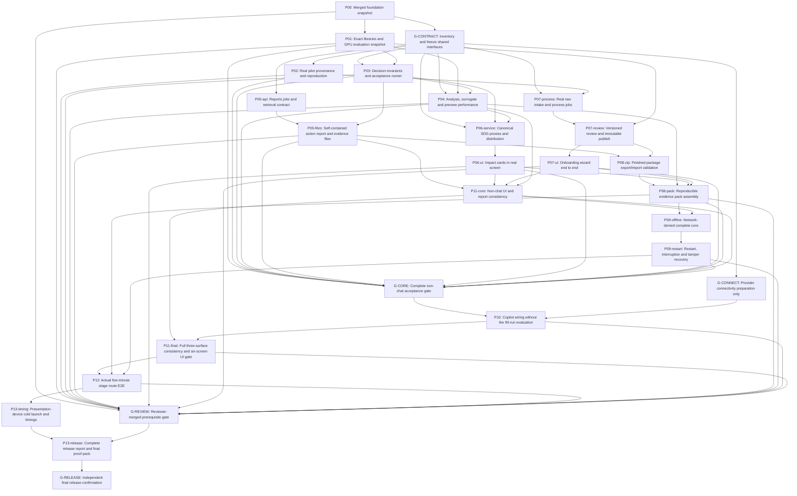

# AabFlow complete work DAG

Generated from [agent-dag.json](agent-dag.json); regenerate with `python scripts/agent_dag.py document` inside Docker.
Read [AGENT_WORKFLOW.md](AGENT_WORKFLOW.md) for execution, ownership, isolated runtimes, checkpoints and reviewer gates.
This graph is a plan, not evidence of executed product work.

| Node | Owner | Prerequisites | Exclusive resources |
|---|---|---|---|
| P00 | lead | — | — |
| P01 | science | P00 | — |
| G-CONTRACT | lead | P00 | contracts |
| P02 | data | G-CONTRACT | science |
| P03 | api | G-CONTRACT, P01 | science |
| P05-api | api | G-CONTRACT | — |
| P04 | science | G-CONTRACT, P01, P03 | science, gpu |
| P05-files | api | P05-api, P03 | — |
| P06-service | api | G-CONTRACT, P03, P04 | — |
| P06-ui | ui | P06-service | — |
| P07-process | data | G-CONTRACT, P02 | science, gpu |
| P07-review | data | P07-process, P01 | science |
| P07-ui | ui | P07-review | demo |
| P08-zip | api | P05-files, P07-review | — |
| P08-pack | api | P08-zip, P04, P06-ui, P07-ui | — |
| P11-core | ui | P05-files, P06-ui, P07-ui, P04 | demo |
| P09-offline | api | P08-pack, P11-core | demo, science |
| P09-restart | api | P09-offline | demo, science |
| G-CORE | verifier | P01, P02, P03, P04, P05-files, P06-ui, P07-ui, P08-pack, P09-restart, P11-core | demo, science |
| G-CONNECT | lead | G-CONTRACT | provider |
| P10 | api | G-CORE, G-CONNECT | provider |
| P11-final | ui | P11-core, P10 | demo, provider |
| P12 | ui | P11-final, P08-pack, P09-restart | demo, provider, science |
| P13-timing | verifier | P12 | demo, science, provider |
| G-REVIEW | lead | P00, P01, P02, P03, P04, P05-files, P06-ui, P07-ui, P08-pack, P09-restart, P10, P11-final, P12 | — |
| P13-release | lead | P13-timing, G-REVIEW | demo, science, provider |
| G-RELEASE | lead | P13-release | demo, science, provider |

Forecast waves below assume existing prerequisites and future reviews succeed; they are not dispatch permission or time estimates. Runtime `plan --state` uses actual checkpoint/lease records. Bases must contain all prerequisite SHAs.

1. G-CONTRACT
2. P02, P05-api, G-CONNECT
3. P03
4. P04, P05-files
5. P06-service, P07-process
6. P06-ui, P07-review
7. P07-ui, P08-zip
8. P08-pack, P11-core
9. P09-offline
10. P09-restart
11. G-CORE
12. P10
13. P11-final
14. P12
15. P13-timing, G-REVIEW
16. P13-release
17. G-RELEASE

All split nodes retain their parent PNN completion barrier. P11-core is partial AT13/AT14; G-CORE unlocks P10; P11-final completes both ATs. G-REVIEW and G-RELEASE require actual independent reviewer merges/evidence.
